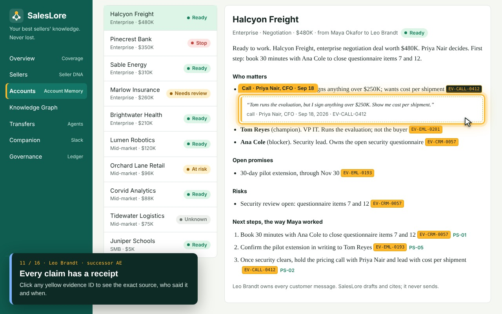
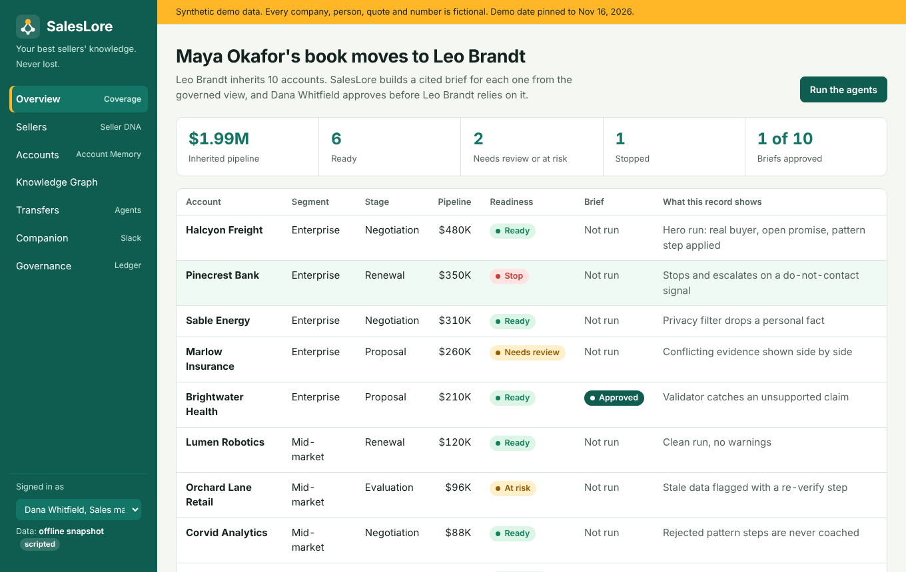
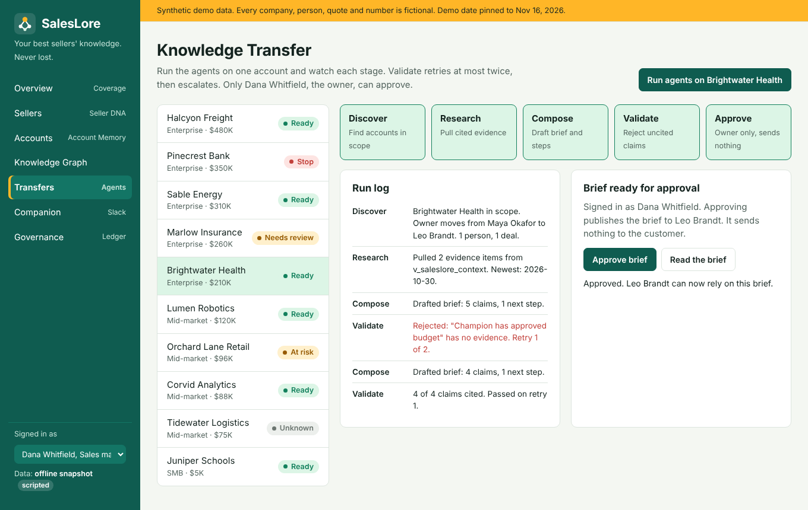
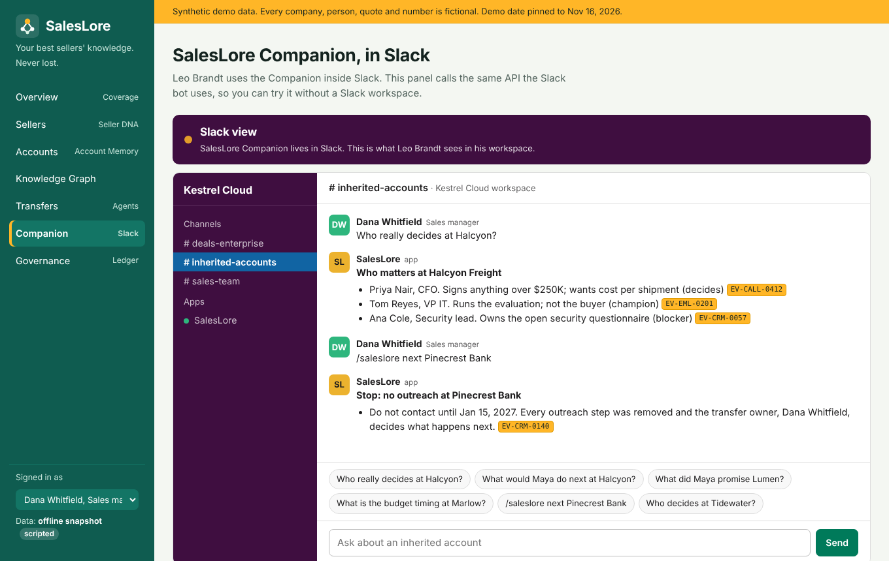
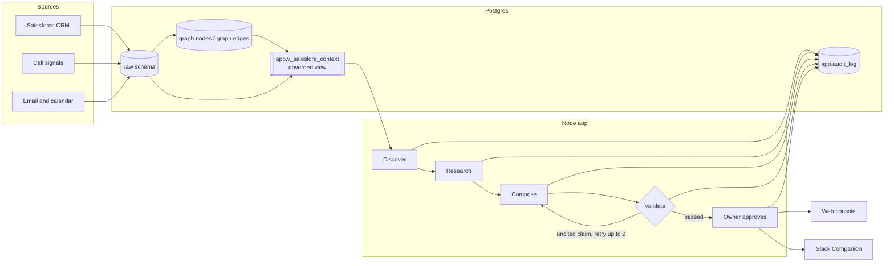

<p align="center"></p>

<p align="center"><b>Your best sellers' knowledge. Never lost.</b></p>

SalesLore is institutional memory for sales teams. When a top account executive leaves, SalesLore keeps what they knew about each account (who really decides, what was promised, what to watch for) and how they worked (what they checked first, how they sequenced a deal). It turns that into a cited brief for the next seller, a manager approves it, and the successor gets help in Slack. Every claim links back to the call, email or CRM field it came from. Nothing is ever sent to a customer.

[](docs/video/saleslore-walkthrough.mp4)

▶ **[Watch the 3-minute captioned walkthrough](docs/video/saleslore-walkthrough.mp4)** (no sound, recorded from the real app with fictional data)

> **All data in this repository is fictional.** Kestrel Cloud, every account, person, quote and number is synthetic. Emails use the reserved `.example` domain. This is a portfolio prototype, not a commercial product.

## Contents

- [Why this exists](#why-this-exists)
- [Try it in 2 minutes (no accounts needed)](#try-it-in-2-minutes-no-accounts-needed)
- [Ways to run it](#ways-to-run-it)
- [Using the web console](#using-the-web-console)
- [Using the Slack bot](#using-the-slack-bot)
- [The demo records](#the-demo-records)
- [How it works](#how-it-works)
- [Beyond the prototype](#beyond-the-prototype)
- [Full setup](#full-setup)
- [Configuration](#configuration)
- [HTTP API](#http-api)
- [Re-recording the walkthrough video](#re-recording-the-walkthrough-video)
- [Testing](#testing)
- [Project layout](#project-layout)
- [Security and data handling](#security-and-data-handling)
- [Troubleshooting](#troubleshooting)
- [FAQ and known limitations](#faq-and-known-limitations)
- [License](#license)

## Why this exists

Sales knowledge is concentrated in a few people, ramping a replacement takes half a year, and much of what the best sellers know never reaches a system.

| Signal | Number | Source |
| --- | --- | --- |
| Revenue concentration | The top 14% of sellers generate 80% of revenue (655K opportunities analyzed) | [Ebsta × Pavilion, 2025 GTM Benchmarks](https://www.joinpavilion.com/resource/2025-gtm-benchmarks-ebsta-pavilion) |
| Time to ramp a new AE | 6.2 months on average, the highest in the study's history | [The Bridge Group, 2026 AE report](https://www.bridgegroupinc.com/research/2026-ae-models-motions-metrics) |
| Knowledge held by one person | 42% of institutional knowledge is unique to the individual | [Panopto, 2018](https://panopto.com/?p=2088) |
| AI that does not help | By 2028 AI agents will outnumber sellers 10 to 1, yet fewer than 40% of sellers "will say AI agents have improved productivity" (prediction) | [Gartner, July 2026](https://www.gartner.com/en/newsroom/press-releases/2026-07-28-gartner-predicts-ai-agents-will-outnumber-sellers-10-to-1-by-2028-yet-fewer-than-40-percent-of-sellers-will-say-agents-improved-productivity) |

Most sales AI learns from what your organization does. SalesLore preserves what your best people know.

| Principle | What it means in the product |
| --- | --- |
| Evidence before answers | The Validate agent rejects any claim without an evidence ID, retries at most twice, then escalates |
| Consent before capture | Capture runs only for a seller who granted consent; they approve, edit or reject their own pattern steps |
| Human ownership | Only the transfer owner can approve a brief; the successor owns every customer message |
| Privacy by design | Personal, non-business facts are excluded before they reach the graph |
| Transparency | Unknown, stale and conflicting facts are labeled, never guessed |
| Auditability | Every agent step, approval and denial is written to the audit log |
| No impersonation | SalesLore has no send action and never speaks as the departed seller |

## Try it in 2 minutes (no accounts needed)

You need **Node.js 22 or newer** (`node -v` to check; on a Mac, install it from [nodejs.org](https://nodejs.org) or with `brew install node`). Offline mode needs no database, Salesforce or Slack.

```bash
git clone https://github.com/hithakishore-all/saleslore.git
cd saleslore
npm ci
npm run offline
```

Open http://127.0.0.1:3000. Press `Ctrl+C` in the terminal to stop.

No git? Download the ZIP from the repository page (**Code > Download ZIP**), unzip it, open Terminal in that folder, then run `npm ci` and `npm run offline`.

## Ways to run it

| Mode | Command | Needs | Data comes from |
| --- | --- | --- | --- |
| Offline | `npm run offline` | Node.js | `fixtures/snapshot.json`, built from the real SQL |
| Offline + Slack | `npm run offline` with Slack tokens in `.env` | Node.js, a Slack app | Same snapshot |
| Live | `npm start` | Node.js, Postgres (free) | Your Postgres database |
| Live + Salesforce IDs | `npm run sf:seed`, `sf:export`, `sf:sync`, `db:setup`, then `npm start` | Also a free Salesforce Developer Edition org | Postgres, with real Salesforce record IDs |

Offline mode keeps runs and approvals in memory, so they reset when you restart. Live mode stores them in Postgres.

## Using the web console



The sidebar has the seven product areas. Use **Signed in as** (bottom left) to switch between Dana Whitfield (sales manager, the transfer owner), Leo Brandt (successor AE) and Maya Okafor (departing AE).

| Area | What you do there |
| --- | --- |
| Overview | See the transfer, inherited pipeline and each account's readiness |
| Sellers (Seller DNA) | Read the departing seller's approved and rejected pattern steps |
| Accounts (Account Memory) | Read an account's brief. Click any yellow receipt (for example `EV-CALL-0412`) to open the source in place |
| Knowledge Graph | See the context graph for one account. Click a node to see its evidence |
| Transfers | Press **Run agents on ...** to watch Discover, Research, Compose and Validate, then **Approve brief** |
| Companion | Ask questions in a Slack-style view. It calls the same API as the real Slack bot |
| Governance (Evidence Ledger) | Read the audit log of every agent step and human decision |

A good first path: **Transfers > Brightwater Health > Run agents**. The validator rejects the unsupported claim "Champion has approved budget", Compose retries, and you approve. Then switch to Leo Brandt and try to approve again: only the owner can.



## Using the Slack bot



After [Slack setup](docs/SETUP_SLACK.md), the bot connects through Socket Mode (no public URL). In any channel the bot is in:

| Command | What it does |
| --- | --- |
| `/saleslore help` | Lists the commands |
| `/saleslore brief Halcyon Freight` | The account brief: segment, stage, readiness, flags |
| `/saleslore next Lumen Robotics` | What the departing seller would do next, with evidence IDs and pattern steps |
| `/saleslore ask who decides at Halcyon?` | Any question: who decides, promises, risks, budget timing, next steps |
| `/saleslore run Halcyon Freight` | Runs the agents and posts the log with an **Approve brief** button |
| `@SalesLore who decides at Marlow?` | Same as ask, answered in a thread |

**Approve brief** works only for the Slack user mapped to the transfer owner in `SALESLORE_SLACK_USER_MAP`. Anyone else gets "Only the transfer owner, Dana Whitfield, can approve this brief." Approving sends nothing to the customer.

## The demo records

Ten fictional accounts, each built to prove one behavior.

| Account | Readiness | What it demonstrates |
| --- | --- | --- |
| Halcyon Freight | Ready | Hero run: the CFO, not the VP of IT, decides; an open 30-day pilot promise; pattern step PS-01 (clear security review before pricing) applied |
| Brightwater Health | Ready | The validator rejects an uncited claim from the seller's notes and the brief passes on retry 1 |
| Orchard Lane Retail | At risk | Stale data: champion last contacted 140 days ago and their email bounced |
| Pinecrest Bank | Stop | Do-not-contact until Jan 15, 2027: every outreach step removed, escalated, cannot be approved |
| Lumen Robotics | Ready | Clean run, no warnings |
| Tidewater Logistics | Unknown | No decision maker, budget or timeline on record: shown as unknown, never guessed |
| Marlow Insurance | Needs review | An email says Q1 budget, a later call says Q2: both shown side by side |
| Sable Energy | Ready | The privacy filter excluded one personal fact before it reached the graph |
| Juniper Schools | Ready | Pattern step PS-04 (multi-thread to five contacts) skipped: it applies to enterprise deals only |
| Corvid Analytics | Ready | Pattern step PS-08 (quarter-end discount) was rejected by the seller and is never coached |

## How it works



| Stage | Reads | Produces | Guardrail |
| --- | --- | --- | --- |
| Discover | `app.v_accounts`, `app.v_transfers`, `app.v_sellers` | The account in scope, old and new owner | Stops if the departing seller has not granted consent |
| Research | `app.v_saleslore_context`, `app.v_evidence` | Cited evidence for the account | Personal evidence never appears in these views |
| Compose | Context rows | Claims, next steps, unknowns, conflicts | Rejected pattern steps and out-of-scope steps are skipped; outreach is dropped on stop |
| Validate | Compose output, evidence IDs | Pass, retry or escalate | Every claim needs an evidence ID that exists; at most 2 retries |
| Approve | The validated run | An approval record | Owner only; idempotent; sends nothing |

Details: [docs/ARCHITECTURE.md](docs/ARCHITECTURE.md).

## Beyond the prototype

The governed view is the product's core, so other front ends can sit on top of it:

- **Claude via MCP:** expose `app.v_saleslore_context` through a read-only Postgres MCP server so Claude can answer "what did Maya promise Lumen?" with the same evidence IDs.
- **Glean:** index approved briefs as documents so enterprise search finds them.
- **Hex or a BI tool:** a coverage dashboard on `app.v_accounts` and `app.approvals`.
- **Streamlit in Snowflake:** the same SQL runs on Snowflake with small changes, if a team prefers its warehouse.
- **Salesforce panel:** a Lightning component showing the brief on the Account page, keyed by `sf_account_id`.
- **A live model:** set `MODEL=anthropic` to have a live model phrase the summary. Claims and evidence still come only from the governed view.

## Full setup

| Step | Guide | Time |
| --- | --- | --- |
| 1. Postgres (free) | [docs/SETUP_POSTGRES.md](docs/SETUP_POSTGRES.md) | 10 minutes |
| 2. Slack (optional) | [docs/SETUP_SLACK.md](docs/SETUP_SLACK.md) | 10 minutes |
| 3. Salesforce (optional) | [docs/SETUP_SALESFORCE.md](docs/SETUP_SALESFORCE.md) | 15 minutes |

**Easiest on a Mac:** with Postgres installed, double-click `scripts/setup-mac.command` in Finder. It does every step below and starts SalesLore.

Short version on a Mac with [Postgres.app](https://postgresapp.com):

```bash
cp .env.example .env              # then edit .env (see docs/SETUP_POSTGRES.md)
createdb saleslore
npm run db:setup                  # creates schemas, seed data, graph, views, app user
npm start                         # live mode
```

## Configuration

Environment variables (in `.env`, never committed):

| Variable | Default | Purpose |
| --- | --- | --- |
| `DATABASE_URL` | none | Live mode connection for the `saleslore_app` user |
| `DATABASE_ADMIN_URL` | none | Admin connection used only by `npm run db:setup` |
| `SALESLORE_DB_PASSWORD` | none | If set, `db:setup` sets the `saleslore_app` password to it |
| `SALESLORE_DB_POOL_MAX` | `5` | Postgres connection pool size |
| `SALESLORE_HOST` | `127.0.0.1` | Address the web console binds to. `0.0.0.0` opens it to your network |
| `PORT` | `3000` | Web console port |
| `SALESLORE_OFFLINE` | unset | `1` is the same as `--offline` |
| `MODEL` | `scripted` | `scripted` or `anthropic` (summary wording only) |
| `ANTHROPIC_API_KEY` | none | Needed when `MODEL=anthropic` |
| `ANTHROPIC_MODEL` | `claude-sonnet-5-5` | Model name for live wording |
| `SLACK_BOT_TOKEN` | none | Starts with `xoxb-` |
| `SLACK_APP_TOKEN` | none | Starts with `xapp-`, scope `connections:write` |
| `SALESLORE_SLACK_USER_MAP` | none | `U0123ABC=dana,U0456DEF=leo` maps Slack users to SalesLore users |

Database settings (table `app.config`, written by the seed):

| Key | Value | Purpose |
| --- | --- | --- |
| `demo_today` | `2026-11-16` | Pins "today" so staleness and stop rules never drift. Delete the row to use the real date |
| `stale_after_days` | `90` | Contacts or facts older than this are flagged stale |
| `max_validate_retries` | `2` | How many times Compose may retry before escalating |

## HTTP API

All routes return JSON. Send `X-SalesLore-User: dana` (or `leo`, `maya`) to act as a user; this is a demo identity, so put SSO in front of it before any real use.

| Method | Route | What it does |
| --- | --- | --- |
| GET | `/api/health` | Store mode, database reachability, model and Slack status |
| GET | `/api/bootstrap` | Transfer, sellers, accounts with readiness and approval, pattern steps |
| GET | `/api/accounts/:id` | The latest brief (or a validated preview) and the run log |
| GET | `/api/accounts/:id/graph` | Context graph nodes and edges for the account |
| POST | `/api/accounts/:id/runs` | Runs Discover, Research, Compose and Validate. 201 with the run |
| POST | `/api/runs/:runId/approve` | Owner-only approval. 201 first time, 200 if already approved, 403 not the owner, 409 nothing to approve |
| POST | `/api/ask` | `{"question": "...", "account_id": "halcyon"}`: Companion answer with evidence IDs |
| GET | `/api/evidence/:id` | One evidence record, for receipts |
| GET | `/api/audit?limit=100` | Audit log, newest first |

Bad input returns 400 with a message that says what to send; unknown records return 404.

## Re-recording the walkthrough video

`npm run video` starts the app offline, drives it with a visible cursor, captions and highlights (`scripts/video/record.py` and `overlay.js`), then encodes `docs/video/saleslore-walkthrough.mp4` with chapters (`scripts/video/encode.py`). It needs Python Playwright with Chromium and ffmpeg. Set `CHROME=/path/to/chrome` to use an installed Chrome.

## Testing

```bash
npm test
```

`test/smoke.test.js` starts the real server in offline mode on a free port and walks the whole workflow through the API: readiness for every scenario, evidence on every claim, the validator retry, owner-only and idempotent approval, the stop rule, unknowns, conflicts, privacy, pattern rules, the Companion, 4xx errors and the audit log. `test/units.test.js` checks configuration messages and that `fixtures/snapshot.json` still matches what the SQL produces.

CI ([.github/workflows/ci.yml](.github/workflows/ci.yml)) also regenerates the seed files and fails if they drift.

## Project layout

```
saleslore/
├── data/
│   ├── generate_data.py        one script creates every seed file
│   └── seed/seed.json          the canonical fictional dataset
├── db/sql/
│   ├── 01_setup.sql            schemas, config, app.today()
│   ├── 02_tables.sql           raw, graph and app tables
│   ├── 03_seed.sql             generated seed data
│   ├── 04_graph.sql            graph.rebuild(): the context graph
│   ├── 05_views.sql            the governed views agents read
│   ├── 06_sync_sample.sql      stand-in Salesforce IDs (06_sync.sql if you sync a real org)
│   └── 07_app_role.sql         least-privilege saleslore_app user
├── salesforce/seed.apex        generated anonymous Apex for a Developer Edition org
├── fixtures/snapshot.json      offline data, built from the SQL by scripts/build-fixtures.mjs
├── scripts/                    setup-mac.command, db-setup, build-fixtures, sf-export, build-sync-sql
├── src/
│   ├── index.js                entry point, config checks, clean shutdown
│   ├── config.js               environment and checks
│   ├── server.js               Express API and web console
│   ├── slack.js                Slack bot (Bolt, Socket Mode)
│   ├── companion.js            question answering shared by Slack and web
│   ├── engine/agents.js        Discover, Research, Compose, Validate, Approve
│   ├── engine/model.js         scripted or live wording
│   └── store/                  live (Postgres) and offline (snapshot) stores
├── public/                     web console (HTML, JS, icon)
├── test/                       end-to-end and unit tests
├── docs/                       setup guides, architecture, troubleshooting, screenshots, brand, video
├── slack-manifest.yml          create the Slack app from this
└── .env.example                configuration template
```

## Security and data handling

- **No secrets in the repo.** `.env`, `.keys/`, Salesforce exports and the real `06_sync.sql` are git-ignored. You paste tokens into `.env` yourself.
- **Least privilege.** The app logs in as `saleslore_app`, which can read only the governed views and write only runs, approvals and the audit log. It cannot read the `raw` schema.
- **Local by default.** The web console binds to `127.0.0.1`.
- **Demo identity.** The user picker and `X-SalesLore-User` header are for demos. Use SSO and real authorization before handling real data.
- **No customer-facing actions.** There is no send, email or call action anywhere in the code.
- **Privacy.** Personal evidence is excluded from every view; only a count of excluded facts is shown.

See [SECURITY.md](SECURITY.md) to report a problem.

## Troubleshooting

| Symptom | Fix |
| --- | --- |
| `SalesLore cannot start yet: DATABASE_URL is not set` | Run `npm run offline`, or set up Postgres ([guide](docs/SETUP_POSTGRES.md)) |
| `Cannot reach Postgres` | Start Postgres.app and check `DATABASE_URL` |
| `Port 3000 is already in use` | Set `PORT=3001` in `.env` |
| Slack bot off | Check both tokens are in `.env` and start with `xoxb-` and `xapp-` |
| `/saleslore` says "dispatch_failed" | The app is not running, or Socket Mode is off in the Slack app settings |

More in [docs/TROUBLESHOOTING.md](docs/TROUBLESHOOTING.md).

## FAQ and known limitations

**Is the AI real?** The agent logic (filtering, validation, stop rules, unknowns, conflicts, approvals) is real code running on real SQL. The wording is scripted by default so the demo is deterministic and free. `MODEL=anthropic` lets a live model phrase the summary; it never adds claims.

**Does it read real Gong calls or email?** No. Call and email signals are fictional rows in `raw.evidence`. Real connectors are on the roadmap.

**Why Postgres?** It is free, runs on a laptop, and anyone can reproduce the live version. The SQL is plain enough to port to Snowflake.

**Known limitations:** single transfer at a time; demo identity instead of SSO; scripted pattern distillation (the pattern steps are seeded, not learned); the graph view lays out a few nodes per type and is not a general graph explorer; offline runs reset on restart.

## License

[MIT](LICENSE) © 2026 Hitha Kishore
