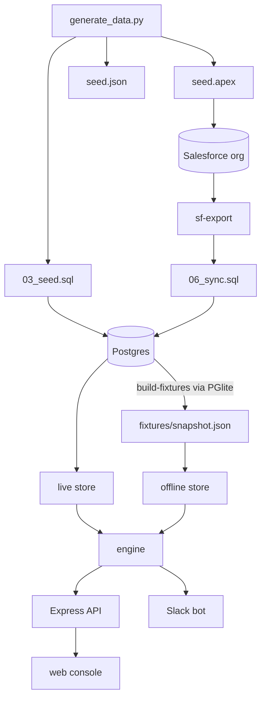
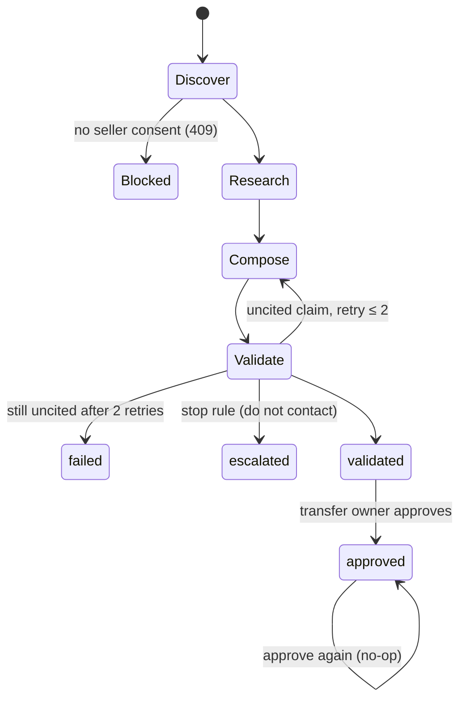

# SalesLore architecture

## Components

| Component | Where | Job |
| --- | --- | --- |
| Data generator | `data/generate_data.py` | Creates every seed file from one dataset, so Postgres, Salesforce and offline data always agree |
| Salesforce (optional) | `salesforce/seed.apex`, `scripts/sf-export.mjs`, `scripts/build-sync-sql.mjs` | System of record; its IDs are synced onto raw rows |
| Postgres | `db/sql/*.sql` | Raw data, context graph, governed views, runs, approvals, audit log |
| Engine | `src/engine/agents.js` | Discover, Research, Compose, Validate; owner-only Approve |
| Wording | `src/engine/model.js` | Scripted summary, or a live model behind `MODEL=anthropic` |
| Stores | `src/store/live.js`, `src/store/offline.js` | Same interface over Postgres or the fixtures snapshot |
| Web console + API | `src/server.js`, `public/` | Express app on 127.0.0.1 |
| Slack bot | `src/slack.js` | Bolt in Socket Mode; `/saleslore`, mentions, Approve button |
| Companion | `src/companion.js` | Question answering shared by Slack and web |



## Data model

**raw schema** (sources): `sellers`, `transfers`, `accounts`, `opportunities`, `contacts`, `evidence`, `facts`, `seller_notes`, `pattern_steps`, `tasks`, `stage_order`.

**graph schema** (the context graph): `nodes` and `edges`, rebuilt by `graph.rebuild()`.

| Node type | ID pattern | Example |
| --- | --- | --- |
| seller | `seller:<id>` | `seller:maya` |
| account | `acct:<id>` | `acct:halcyon` |
| opportunity | `opp:O-<account>` | `opp:O-halcyon` |
| person | `person:<contact_id>` | `person:C-001` (Priya Nair) |
| commitment, risk, fact | `fact:<fact_id>` | `fact:F-001` (pilot extension) |
| pattern_step | `ps:<step_id>` | `ps:PS-01` |
| unknown | `unknown:<kind>:<account>` | `unknown:dm:tidewater` |

| Edge rel | From → To |
| --- | --- |
| `owns` | seller → account |
| `has_deal` | account → opportunity |
| `decides_for`, `champion_of`, `influences` | person → account |
| `blocks` | person or risk → opportunity |
| `promised` | seller → commitment |
| `describes` | fact → account |
| `applies_to` | approved pattern step → opportunity (only where its segment matches) |
| `unknown` | unknown → opportunity |

Every node and edge that comes from a source carries `evidence_id` and `source_date`. Personal evidence never becomes a node or edge.

**app schema** (what the app reads and writes):

| Object | Kind | Notes |
| --- | --- | --- |
| `v_saleslore_context` | view | The one view agents reason over |
| `v_accounts`, `v_transfers`, `v_sellers`, `v_pattern_steps`, `v_evidence` | views | Supporting reads; `v_evidence` excludes personal rows |
| `v_graph_nodes`, `v_graph_edges` | views | The graph, for the console |
| `config` | table | `demo_today`, `stale_after_days`, `max_validate_retries` |
| `runs`, `approvals`, `audit_log` | tables | The only tables the app can write |

## The governed view: app.v_saleslore_context

| Column | Meaning |
| --- | --- |
| `account_id` | The account |
| `item_type` | `person`, `commitment`, `risk`, `fact`, `note`, `task`, `unknown`, `stop`, `privacy_excluded` |
| `item_key` | Source row ID |
| `label`, `detail` | The claim text |
| `relationship` | For people: `decides_for`, `champion_of`, `influences`, `blocks` |
| `fact_key` | Groups facts about the same thing, to detect conflicts (`budget_timing`) |
| `evidence_id`, `source_system`, `source_date`, `speaker`, `quote` | Where it came from |
| `is_stale` | Older than `stale_after_days`, or a bounced email |
| `pattern_step_id`, `pattern_status`, `pattern_applies` | For tasks: the seller's step, whether it was approved, whether it fits this deal |
| `is_outreach`, `sort_order`, `due_date` | Task and commitment details |

Draft notes (`item_type = 'note'`) may have no evidence on purpose: they are what the validator exists to catch.

## Evidence ID patterns

| Pattern | Source |
| --- | --- |
| `EV-CALL-0412` | A call transcript snippet |
| `EV-EML-0193` | An email |
| `EV-CRM-0057` | A Salesforce field or activity |
| `EV-PAT-001` | Evidence for a pattern step (aggregate over many calls or emails) |

## Run lifecycle



## Agents

| Agent | Input | Output | Rules |
| --- | --- | --- | --- |
| Discover | Account, transfer, sellers | Scope line | Requires `consent_status = 'granted'` for the departing seller |
| Research | `v_saleslore_context`, `v_evidence` | Evidence set | Only non-personal evidence is visible |
| Compose | Context rows, rejected keys | Claims, next steps, unknowns, conflicts, skipped steps | Drops rejected and non-applicable pattern steps; drops outreach on stop |
| Validate | Claims, evidence IDs | Pass or list of failures | Any claim without an existing evidence ID fails |
| Approve | Run, actor | Approval | Owner only; `ON CONFLICT DO NOTHING` makes it idempotent |

## The brief (JSON shape)

```json
{
  "account": { "account_id": "halcyon", "name": "Halcyon Freight", "segment": "Enterprise", "stage": "Negotiation", "amount": 480000 },
  "transfer": { "from": "Maya Okafor", "to": "Leo Brandt", "owner": "Dana Whitfield" },
  "status": "ready",
  "flag": null,
  "summary": "Ready to work. Halcyon Freight, enterprise negotiation deal worth $480K. Priya Nair decides. ...",
  "people": [{ "name": "Priya Nair", "relationship": "decides_for", "role": "decides", "text": "...", "evidence_id": "EV-CALL-0412", "stale": false }],
  "commitments": [{ "text": "30-day pilot extension, through Nov 30", "evidence_id": "EV-EML-0193", "due": "2026-11-30" }],
  "risks": [], "facts": [], "conflicts": [], "unknowns": [],
  "next": [{ "text": "Book 30 minutes with Ana Cole ...", "evidence_id": "EV-CRM-0057", "pattern_step_id": "PS-01" }],
  "skipped": [], "privacy_excluded": 0, "stop": null
}
```
`status` is one of `ready`, `review`, `risk`, `stop`, `unknown`. `flag` is `[kind, text]` where kind is `stop`, `warn`, `unk` or `ok`.

## Audit event catalog

| action | actor | When |
| --- | --- | --- |
| `consent`, `distill`, `review`, `transfer_start` | Seller, manager, distiller | Seeded history |
| `discover`, `research`, `compose`, `validate` | `<Stage> agent` | Each agent step; idempotency key `<run_id>:<n>` |
| `approve` | Transfer owner | First approval of a run; key `approve:<run_id>` |
| `approve_denied` | Anyone else | A non-owner tried to approve |
| `ask` | The asking user | A Companion question from the web console |

## Security model

- The app user `saleslore_app` has `SELECT` on the app views and `SELECT, INSERT` on runs, approvals and the audit log. No access to `raw` or `graph` tables directly.
- No route or Slack action sends anything outside SalesLore.
- Input is validated by pattern (ids, evidence IDs, question length) and bad input returns 4xx.
- The server binds to 127.0.0.1 unless `SALESLORE_HOST` says otherwise.

## Design decisions

| Decision | Why |
| --- | --- |
| Postgres, not a graph database | Free, everywhere, and nodes/edges tables plus recursive SQL are enough; Apache AGE can add Cypher later |
| One governed view for agents | One place to enforce privacy, freshness and evidence |
| Scripted wording by default | Deterministic demos and tests; a live model can only phrase, never add claims |
| Offline snapshot built from the real SQL (PGlite) | Offline mode cannot drift from live logic; a test enforces it |
| Approval separate from the run | A person decides; agents never publish to the successor on their own |
| Pinned demo date | Staleness and stop rules give the same answer every day |
